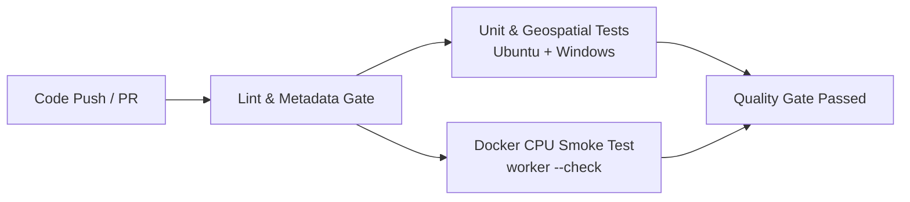

# PalmAI CI/CD Architecture & Quality Gates

This document outlines the Continuous Integration (CI) and Continuous Delivery (CD) architecture for the **PalmAI QGIS Plugin** and its decoupled inference container images.

---

## 1. Core Principles

1. **Unprivileged Pull Request Checks:**
   All PRs targeting `master` execute with minimal read permissions (`contents: read`). Untrusted PR branches are never granted GitHub Container Registry (GHCR) write credentials.
2. **Deterministic & Fast Testing:**
   PR validation runs synthetic geospatial fixtures and mocked backend tests in seconds without requiring real ~500 MB model weight downloads, GUI displays, or GPU hardware.
3. **Reproducible Container Delivery:**
   Production images are built with pinned base packages, tagged immutably (`vX.Y.Z-cpu`, `vX.Y.Z-gpu`), and referenced by cryptographic digests (`sha256:...`). Legacy floating tags (`:cpu`, `:gpu`) are retained only as backward-compatibility aliases.
4. **QGIS Plugin Packaging Isolation:**
   Plugin release ZIP archives are strictly scoped to UI, backend scripts, and core logic, completely excluding model checkpoints, caches, and test fixtures.

---

## 2. GitHub Actions Workflows

The repository organizes delivery into three purpose-built workflows under `.github/workflows/`:

| Workflow File | Purpose | Triggers | Required Permissions |
|---|---|---|---|
| `ci.yml` | Pull Request Quality Gates | PRs targeting `master`/`main`, push to `master`, `workflow_dispatch` | `contents: read` |
| `publish-images.yml` | Versioned Container Image Publication | Tag pushes `v*.*.*`, authorized `workflow_dispatch` | `contents: read`, `packages: write` |
| `release-plugin.yml` | QGIS Plugin Packaging & Release | Tag pushes `v*.*.*`, authorized `workflow_dispatch` | `contents: write` |

---

## 3. CI Quality Gate Stages (`ci.yml`)

Every pull request and push to the default branch undergoes automated validation:

### Stage 1: Lint & Metadata Validation
- **Ruff Linter:** Enforces PEP 8, import sorting (isort), and code style across `plugin_qgis/`, `scripts/`, and `tests/`.
- **Plugin Metadata Validator (`test_plugin_metadata.py`):** Ensures `plugin_qgis/metadata.txt` satisfies official QGIS plugin repository specifications:
  - Valid `[general]` INI section.
  - Non-placeholder tracker, repository, and homepage URLs (`https://github.com/Anovvy/PalmAI_Plugin`).
  - Valid icon file path pointing to an existing relative asset.
  - Explicit QGIS 3 compatibility range (`qgisMinimumVersion=3.22`, `qgisMaximumVersion=3.99`).

### Stage 2: Core & Synthetic Geospatial Tests
- Runs on both **Ubuntu** and **Windows** runners.
- Executes `pytest` across all units:
  - `test_path_mapping.py`: Mount de-duplication, least-privilege modes (`:ro` for inputs, `:rw` for outputs), cross-platform path normalization.
  - `test_docker_backend.py`: Daemon diagnostic reporting, pull fallback to build, automatic CPU fallback, `--gpus all` management.
  - `test_venv_backend.py`: Python interpreter discovery, exclusion of embedded QGIS Python, wheel index selection.
  - `test_worker_protocol.py`: `@@PALMAI@@` JSON-lines message parsing, error and traceback forwarding, cancellation.
  - `test_model_store.py`: Cryptographic SHA-256 verification, atomic `.part` replacement, retry behavior.
  - `test_geospatial_core.py`: Affine transforms, bounding box polygon construction, centroid point calculations, Shapefile attribute schema.
  - `test_geospatial_qa.py`: Road network skeletonization, line continuity, and run manifest provenance.

### Stage 3: Docker CPU Smoke Test
- Builds the `plugin_qgis/docker/Dockerfile.cpu` image in GitHub Actions using Buildx.
- Runs `python -m palmai_core.worker --check` inside the built container to verify dependencies (Torch, Ultralytics, SAHI, GDAL/Rasterio, Fiona, Shapely) without downloading heavy weights.

---

## 4. Container Delivery Pipeline (`publish-images.yml`)

When an authorized release tag (`vX.Y.Z`) is pushed:

1. **Pre-Publish Verification:** Re-runs the full test suite before building images.
2. **Multi-Variant Build:**
   - `Dockerfile.cpu` -> `ghcr.io/anovvy/palmai-core:vX.Y.Z-cpu` and `:cpu`
   - `Dockerfile.gpu` -> `ghcr.io/anovvy/palmai-core:vX.Y.Z-gpu` and `:gpu`
3. **OCI Labels Injection:** Embeds source repository, Git revision SHA, version tag, and license into container image metadata.
4. **Digest Logging:** Outputs exact `sha256:...` repo digests to GitHub Step Summary for provenance and reproducible rollback.

---

## 5. Plugin Packaging & Release Pipeline (`release-plugin.yml`)

1. Executes `scripts/package_plugin.py --dist-dir dist`.
2. Assembles the plugin under the mandatory root directory `PalmAI/`.
3. Strips binary model files (`.pt`, `.pth.tar`), bytecode caches (`__pycache__`), and git files, producing a lightweight (~100 KB) ZIP archive.
4. Generates `PalmAI.zip.sha256` checksum.
5. Attaches the ZIP and checksum to the official GitHub Release assets.
